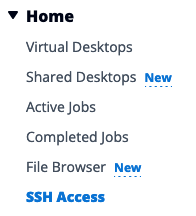
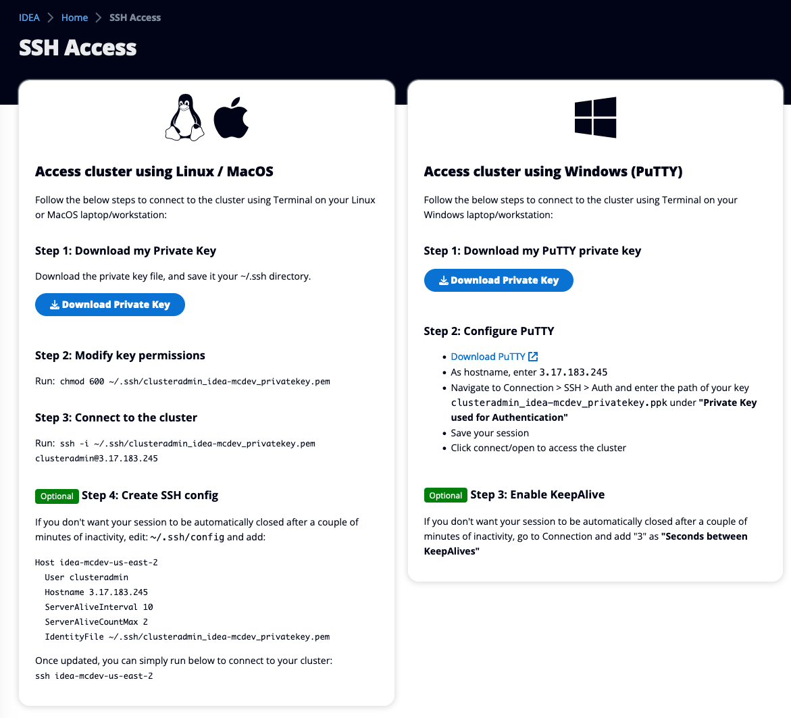

# SSH access

If needed, you can SSH to the bastion host. First open your IDEA [web-interface.md](web-interface.md "mention") and click "**SSH access**" session on the left sidebar

<figure><figcaption></figcaption></figure>

IDEA will offers you two ways to establish an SSH connection. Follow the instructions displayed on the screen whether you are planning to use a regular SSH client or PuTTY (Windows)

<figure><figcaption>
Follow the instructions to configure your SSH client
</figcaption></figure>

## Post-quantum key exchange

On supported Linux hosts, the SSH configuration puts supported post-quantum key exchange algorithms ahead of the existing algorithms. Hybrid ML-KEM is included when the installed SSH software supports it. Older servers that offer no supported post-quantum algorithm keep their existing configuration.

For running desktops, the controller checks every six hours and attempts at most five refreshes per pass. Only READY Linux desktops with a server instance and no recorded successful refresh are eligible. Larger fleets take multiple passes; stopped desktops are skipped until READY. The SSH service restarts after the new configuration passes validation. Open SSH sessions stay connected.

### Bastion SSH source addresses

`ssh_client_ip` in values.yml is the source of truth for `cluster.network.ssh_client_ip`.
Each upgrade replaces the stored list, including removing addresses. An empty list or an
omitted key restores the default cluster and operator prefix lists for SSH. The upgrade
preview labels changed lists as `VALUES_UPDATE` and shows the old and new addresses. Replacing a differing stored list requires drift confirmation (or `--accept-config-drift` for unattended runs). Both IP settings must be lists of IPv4 addresses or network CIDRs without host bits; addresses normalize to `/32` and duplicates are removed. `ideactl config set` can change the setting
immediately, but the next upgrade restores values.yml; edit that file for a lasting change.
