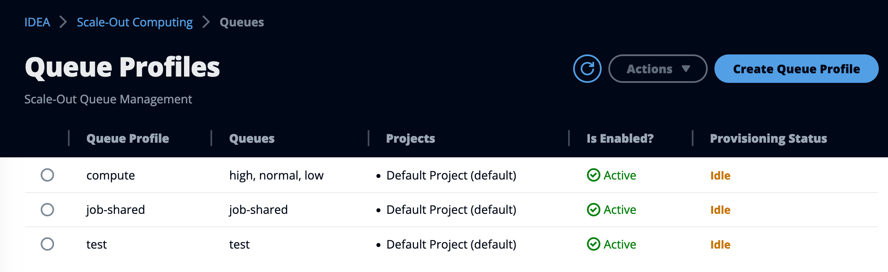

# Queue Profiles

IDEA let you create queues and queue profiles. To access this section, click "**Administration**" > "**Manage jobs**" > "**Queues**"


You must have admin permission to the Scale-Out Compute module


<figure><figcaption><p>Default queue profiles</p></figcaption></figure>

A queue is is a resource that can handle and execute user jobs. A queue profile extends queue functionalities by specifying default compute/storage values. You can have multiple queues registered to one queue profile.

Each profile have a set of default values (instance\_type, instance\_ami ...) that are automatically applied to the simulation jobs if not specified by the users during the job submission.

Example1:

```bash
qsub -q normal -- myscript.sh
```

In this example, no job resources are specified during the qsub command. IDEA will determine instance type, AMI and all other required parameters based on the default values specified on [#instance-info](queue-profiles.md#instance-info "mention") for the queue called "normal".

Example 2:

```
qsub -q normal \
     -l instance_type=c5.xlarge \
     -l instance_ami=ami-abcde123 \
     -l scratch_size=500 \
     myscript.sh
```

In this example, IDEA honors the job resources specified by the user (`instance_type`, `instance_ami` and `scratch_size`) Other required parameters will be based on the default values specified on [#instance-info](queue-profiles.md#instance-info "mention") for the queue called "normal".


As administrator, you can prevent users to specify specific job resources via [#restricted-parameters](queue-profiles.md#restricted-parameters "mention")


## Create a queue profile

To create a queue profile, click "**Create Queue Profile**" button.

## Edit a queue profile

To edit a queue profile, select the profile and click "**Action**" > "**Edit Queue Profile**"

## Enable/Disable a queue profile

## Queue Profile Parameters

### Basic Info

#### Name

Choose a name for the queue profile. Name must be all lowercase and should not contain spaces or special characters except (-)

#### Title

Choose a user friendly title for the queue profile

#### Projects

Select applicable projects for the queue profile. Refer to [projects-management.md](../../cluster-manager/projects-management.md "mention") to learn more about how projects work.

### Operating Modes

#### Scheduler Queues

Select the queue(s) to add to this queue profile.


* A queue cannot belong to more than one queue profile
* IDEA will automatically create the queue if needed


#### Queue Mode

Select the queue(s) mode.

* First-In First-Out (FIFO): Default, jobs are processed in the order they have been send to the queue
* License Optimized: IDEA will try to maximize licenses consumption and run as many job as possible based on license availabilities. Job order may not be honored.
* Fair Share: IDEA starts jobs based on your own fair share formula

#### Keep Forever

Choose whether or not you want the compute nodes to be automatically deleted once the simulation(s) are complete

#### Scaling Mode

Select the scaling more for the queue(s).

* Single Job: Run one job per compute node (EC2 machine)
* Batch: Run multiple jobs per compute node (EC2 machine)

### Queue Limits

#### Max Running Jobs

Select the number of maximum concurrent running jobs (0 implies no limits)

#### Ma Provisioned Instances

Select the number of maximum concurrent provisioned instances (0 implies no limits)

### Queue ACLs

#### Allow Job Submissions without Project

Select whether or not you want to allow your users to submit their simulation jobs without specify a project (-P \<project\_name>)

#### Allowed Instance Types

List of instance type or instance families allowed to be provisioned by your users for their jobs.

Example:

* c5.large,m5: End users can provision a c5.large or any m5 instance types (e.g: m5.large, m5.xlarge ..) for their jobs.

#### Excluded Instance Types

List of instance type or instance families your users are not authorized to provision for their jobs.

Example:

* c5.large,m5: End users are not authorized to provision c5.large or any m5 instance types (e.g: m5.large, m5.xlarge ..) for their jobs.

#### Restricted Parameters

List of jobs parameters your users are not able to customize.

Example:

* scratch\_size, instance\_type: End users are not authorized to override `scratch_size` and `instance_type` parameters for their jobs and have to use the defaults value specified at the queue profile

Any job can mount an existing FSx for Lustre file system by naming its DNS name in `fsx_lustre`. To stop that on a queue:

1. Go to **Administration** > **Manage jobs** > **Queues**, select the queue profile, and choose **Edit Queue Profile**.
2. In **Restricted Parameters** (`queue_management_params.restricted_parameters`), add `fsx_lustre`.
3. Choose **Update Queue Profile**. A job on that queue that sets `-l fsx_lustre=fs-0123456789abcdef0.fsx.us-east-2.amazonaws.com` is now refused at submission with `Queue <queue> doesn't let jobs set fsx_lustre. Remove it from your job script.`

This blocks every `fsx_lustre` request on the queue, including requests for a new FSx for Lustre file system. The queue's own **Existing FSx for Lustre** (see [Existing FSx for Lustre](queue-profiles.md#existing-fsx-for-lustre)) still applies: jobs can't choose a file system, and every job on the queue mounts the one you set.

A job can also name any machine image the cluster's AWS account can launch, with `-l instance_ami=<ami id>`. Its nodes boot that image with the job's instance role and mount the cluster's shared storage, so the image's contents are trusted with both. To allow only the queue's own image:

1. Go to **Administration** > **Manage jobs** > **Queues**, select the queue profile, and choose **Edit Queue Profile**.
2. In **Restricted Parameters** (`queue_management_params.restricted_parameters`), add `instance_ami`.
3. Choose **Update Queue Profile**. A job on that queue that sets `-l instance_ami=ami-0123456789abcdef0` is now refused at submission with `Queue <queue> doesn't let jobs set instance_ami. Remove it from your job script.` Jobs that don't set it still boot the queue profile's image.

#### Jobs may create a new FSx for Lustre

Controls whether a job on this queue can create its own FSx for Lustre file system for scratch storage. That covers `-l fsx_lustre=true` and `-l fsx_lustre=<bucket>` or `s3://<bucket>`. The file system is billed from creation until IDEA deletes it with the job's compute stack. The setting is saved as `queue_management_params.allow_new_fsx_lustre`.

It doesn't affect mounting an existing file system: a job can still name one by DNS name (unless `fsx_lustre` is a restricted parameter), and the queue's **Existing FSx for Lustre** still applies.

A job that asks for a new file system on a queue that doesn't allow it is refused at submission with `Queue <queue> doesn't let jobs create a new FSx for Lustre file system. Ask an administrator to allow it on the queue, or set fsx_lustre to the DNS name of an existing file system.`

Defaults:

* A queue profile an administrator creates from IDEA 26.11.2 on (portal or API) starts with the box unchecked (not allowed).
* A queue profile that existed before the upgrade has no stored value and allows it, as before. The form shows it checked, so saving the profile changes nothing.
* The built-in queue profiles IDEA creates itself (`compute`, `job-shared` and `test`, at install or when one is re-created after being deleted) are created with it allowed, as they were before.

To turn it off on existing queues after upgrading (for example on a cluster where per-job file systems are a cost you don't want):

1. Go to **Administration** > **Manage jobs** > **Queues**, select the queue profile, and choose **Edit Queue Profile**.
2. Clear **Jobs may create a new FSx for Lustre**.
3. Choose **Update Queue Profile**. New submissions that ask for a new file system are refused.

To see what these file systems cost, an account owner can activate these tags as cost allocation tags in the AWS Billing console. Every file system a job creates carries them: `idea:Project`, `idea:JobId`, `idea:JobOwner`, `idea:JobQueue`, `idea:ClusterName` and `idea:FSx` (`true`). The project's own tags are added too. Cost Explorer can then group FSx spend by `idea:Project`.

#### Allowed Security Groups

List of additional security group(s) users can override via [#security\_groups](../user-documentation/supported-ec2-parameters.md#security\_groups "mention") parameter.


You can assign up to 4 additional security groups per job

You must ensure your security groups have been created with the correct TCP inbound/outbound rules. Failure to do so may prevent your jobs to start


#### Allowed Instance Profiles

List of additional IAM instance profile(s) users can override via [#instance\_profile](../user-documentation/supported-ec2-parameters.md#instance\_profile "mention") parameter.


You must ensure your IAM role(s) have been created with the correct policies. Failure to do so may prevent your jobs to start


When this list is set and Bedrock is enabled for jobs, it must also include the instance profile of every Bedrock enabled project whose jobs use this queue. Those jobs run under the project's instance profile, and a list that omits it rejects them at submission. Leaving the list empty authorizes any instance profile, as before.

### Instance Info

#### Compute Node OS

#### Instance AMI

Choose the default AMI to use for the compute nodes.

Associated Job Resource: [#instance\_ami](../user-documentation/supported-ec2-parameters.md#instance\_ami "mention")

#### Instance Types

Choose the default instance type to provision for the compute nodes. Multiple instance types if provided will be used as weighted capacities. Order is important and must be provided in increasing CPU capacity (e.g: c5.large, c5.xlarge)

Associated Job Resource: [#instance\_type](../user-documentation/supported-ec2-parameters.md#instance\_type "mention")

#### Root Storage Size

Select the size of the root partition for the compute nodes.

Associated Job Resource: [#root\_size](../user-documentation/supported-ec2-parameters.md#root\_size "mention")

#### Keep EBS Volumes ?

Choose whether or not you want to retain ephemeral EBS disks associated to the compute nodes once the simulation has completed.

Associated Job Resource: [#keep\_ebs](../user-documentation/supported-ec2-parameters.md#keep\_ebs "mention")

#### Enable EFA Support ?

Choose whether or not you want to enable EFA support. You must be using a supported instance type ([https://docs.aws.amazon.com/AWSEC2/latest/UserGuide/efa.html#efa-instance-types](https://docs.aws.amazon.com/AWSEC2/latest/UserGuide/efa.html#efa-instance-types)) and a `base_os` with EFA bootstrap support. See [Supported OS & hardware matrix](../user-documentation/supported-os-hardware-matrix.md#efa-support).

Associated Job Resource: [#efa\_support](../user-documentation/supported-ec2-parameters.md#efa\_support "mention")

#### Enable Hyper-Threading ?

Choose whether or not you want to enable hyper threading

Associated Job Resource: [#ht\_support-1](../user-documentation/supported-ec2-parameters.md#ht\_support-1 "mention")

#### Force Reserved Instances ?

Choose whether or not you want to restrict your job to Reserved Instance

Associated Job Resource: [#force\_ri](../user-documentation/supported-ec2-parameters.md#force\_ri "mention")

### Spot Fleet

#### Use Spot Fleet?

Choose whether or not you want to enable support for Spot Fleet.

#### Spot Price

Select the maximum bid for your spot instances.

Associated Job Resource: [#spot\_price](../user-documentation/supported-ec2-parameters.md#spot\_price "mention")

#### Spot Allocation Count

Select the spot allocation logic for your spot instances.

Associated Job Resource: [#spot\_allocation\_count](../user-documentation/supported-ec2-parameters.md#spot\_allocation\_count "mention")

#### Spot Allocation Strategy

Select the spot allocation strategy for your spot instances.

Associated Job Resource: [#spot\_allocation\_strategy](../user-documentation/supported-ec2-parameters.md#spot\_allocation\_strategy "mention")

### Network and Security

#### Subnet IDs

If needed, restrict the default subnet ids that can be used to provision the compute resources. If not set, IDEA will randomly choose on of the privat subnets:

Associated Job Resource: [#subnet\_id](../user-documentation/supported-ec2-parameters.md#subnet\_id "mention")

#### Security Groups

Specify a custom security group if you do not want to use the default one created by IDEA

#### Instance Profile

Specify a custom IAM instance profile if you do not want to use the default one created by IDEA

#### Enable Placement Group?

Choose whether or not you want to enable placement group ([https://docs.aws.amazon.com/AWSEC2/latest/UserGuide/placement-groups.html](https://docs.aws.amazon.com/AWSEC2/latest/UserGuide/placement-groups.html))

Associated Job Resource: [#placement\_group](../user-documentation/supported-ec2-parameters.md#placement\_group "mention")

### Scratch Storage

#### Enable Scratch Storage

Choose whether or not you want to automatically allocate a local scratch partition to the compute nodes.

Associated Job Resource: [#scratch\_size](../user-documentation/supported-ec2-parameters.md#scratch\_size "mention")

#### Scratch Provider

Choose what type of storage provider you want to use for your scratch partition (EBS, FSx ...)

Associated Job Resource: None if EBS, [#fsx\_lustre](../user-documentation/supported-ec2-parameters.md#fsx\_lustre "mention")/ [#fsx\_lustre\_deployment\_type](../user-documentation/supported-ec2-parameters.md#fsx\_lustre\_deployment\_type "mention") for FSx

#### Existing FSx for Lustre

Shown when **Scratch Provider** is **FSx for Lustre (Existing)**. Enter the file system's DNS name, for example `fs-0123456789abcdef0.fsx.us-east-2.amazonaws.com`. It is saved as `default_job_params.fsx_lustre.existing_fsx`.

Every job on the queue that names no file system mounts this one at the FSx mount point (`/fsx` by default). That is a job that sets nothing, or only `-l fsx_lustre=true`. The file system is written to the job when it is submitted, so changing the queue later doesn't change jobs already queued or running.

When `fsx_lustre` isn't a restricted parameter, the job's own request wins:

* `-l fsx_lustre=<another DNS name>` mounts that file system instead.
* `-l fsx_lustre=<bucket>` creates a new FSx for Lustre linked to the bucket, with the new-FSx defaults for size and deployment type. The queue must allow jobs to create one.
* `-l fsx_lustre=false` mounts none.

When `fsx_lustre` is restricted, jobs can't set it and every job mounts the queue's file system.

The default applies only while **Scratch Provider** is **FSx for Lustre (Existing)**. Switching the provider to EBS or to a new FSx removes it. A queue profile written through the API with an existing file system but no scratch provider also applies it.


Before IDEA 26.11.2 this setting was saved but never reached the job. After upgrading, new jobs on such a queue start mounting the file system.


#### Scratch Storage Size

Choose the size (in GB) of the /scratch partition you are about to provision.

Associated Job Resource: [#scratch\_size](../user-documentation/supported-ec2-parameters.md#scratch\_size "mention") / [#fsx\_lustre\_size](../user-documentation/supported-ec2-parameters.md#fsx\_lustre\_size "mention")

#### Scratch Storage Provisioned IOPS

Select the provisioned IOPs you want to allocate. We recommend to set this value as 3X the scratch size

Associated Job Resource: [#scratch\_iops](../user-documentation/supported-ec2-parameters.md#scratch\_iops "mention") for EBS / [#fsx\_lustre\_per\_unit\_throughput](../user-documentation/supported-ec2-parameters.md#fsx\_lustre\_per\_unit\_throughput "mention") for FSx

### Metrics

### Reclaim unavailable job nodes

The scheduler reclaims job nodes that remain **down** or **unknown** past `scheduler.job_provisioning.node_unavailable_timeout_seconds`, which defaults to 1800 seconds. Use the timeout to allow normal bootstrap and brief network interruptions without retaining unusable capacity indefinitely. Nodes marked `keep_forever` are exempt and require manual cleanup.

#### Enable System Metrics?

Select whether or not you want to enable system metrics collection

Associated Job Resource: [#system\_metrics](../user-documentation/supported-ec2-parameters.md#system\_metrics "mention")

#### Enable Anonymous Metrics?

Select whether or not you want to anonymous metrics collection [https://docs.aws.amazon.com/solutions/latest/scale-out-computing-on-aws/collection-of-operational-metrics.html](https://docs.aws.amazon.com/solutions/latest/scale-out-computing-on-aws/collection-of-operational-metrics.html)

Associated Job Resource: [#anonymous\_metrics](../user-documentation/supported-ec2-parameters.md#anonymous\_metrics "mention")
